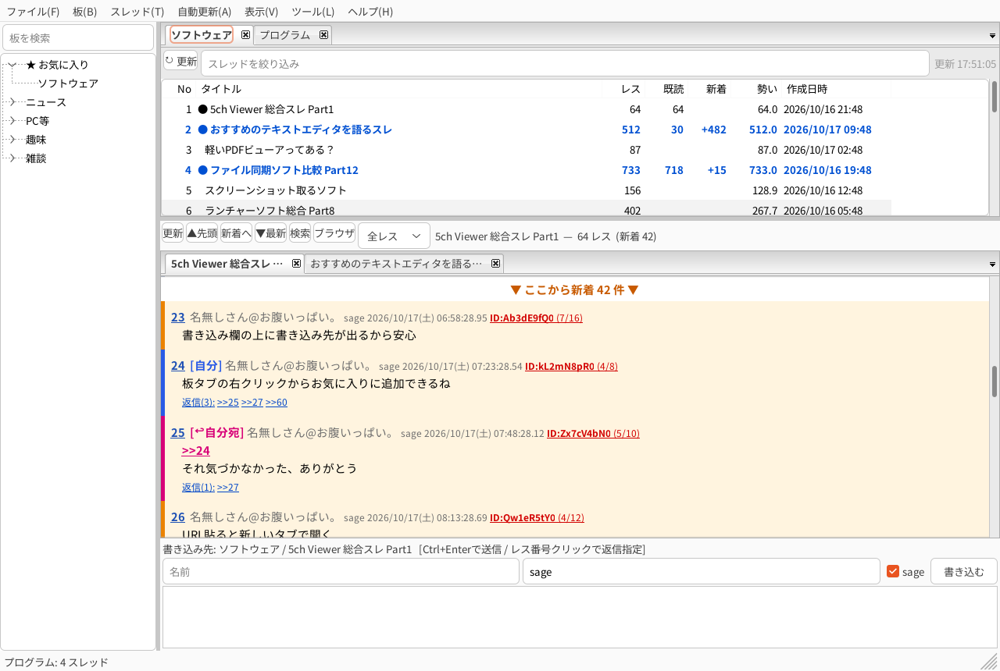
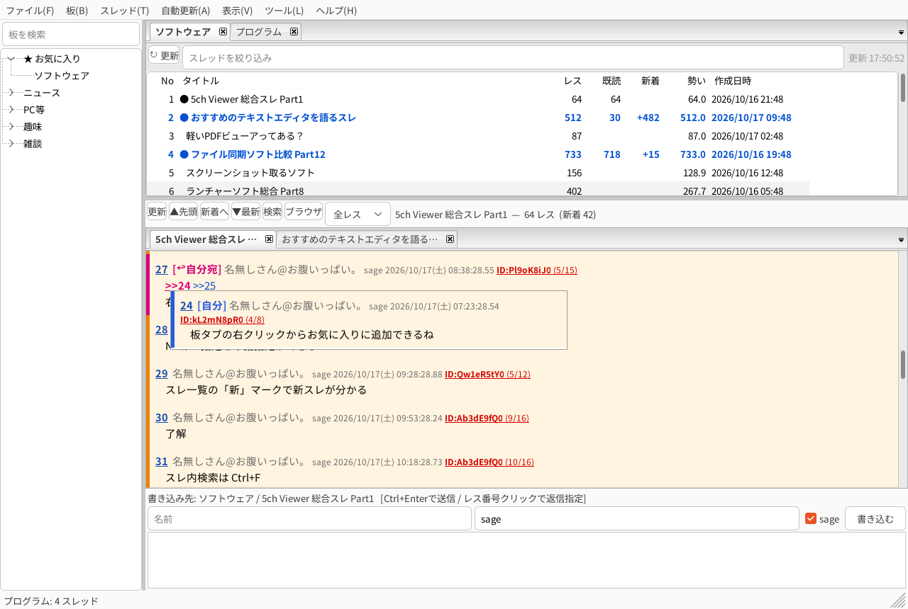
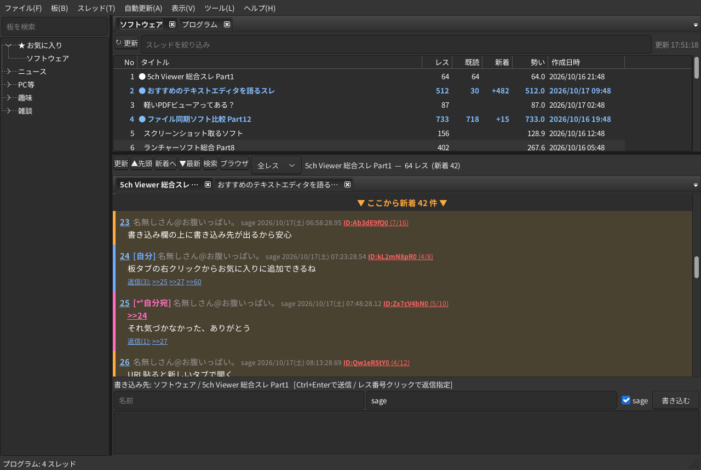

# 5ch Viewer (wxWidgets / C++)
> 非公式の閲覧ソフトです。5ch(5ちゃんねる)の運営とは関係ありません。

5ch.io のタブ対応ビューア。Linux / Windows 両対応。
左: 板ツリー / 右上: 板タブ(スレ一覧) / 右下: スレッドタブ(レス表示) + 書き込み欄。分割バー・ウィンドウサイズ可変。



| `>>N` にマウスを載せると吹き出しで表示 | ダークテーマ |
|---|---|
|  |  |

左が板ツリー、右上が板タブ(スレ一覧)、右下がスレッドタブと書き込み欄です。新着は「ここから新着」の帯と色で、自分の書き込みは `[自分]`、それへの返信は `[↩自分宛]` で示します。
(画面はダミーデータで作成したものです)

## 目次
- [必要なもの](#必要なもの)
- [ビルド](#ビルド)
- [インストール](#インストール)
- [パッケージの作成](#パッケージの作成)
- [データの保存場所](#データの保存場所)
- [操作](#操作)

## 必要なもの
| 対象 | 必要なもの |
|---|---|
| 共通 | C++17 コンパイラ、make、wxWidgets 3.2 (**html と aui を含む**)、libcurl(Linux のみ。wxWebRequest が使用) |
| Linux (Debian/Ubuntu) | `sudo apt install build-essential libwxgtk3.2-dev libcurl4-openssl-dev` |
| Linux (Fedora) | `sudo dnf install gcc-c++ make wxGTK-devel libcurl-devel` |
| Windows クロスビルド (Linux ホスト) | `mingw-w64` (x86_64-w64-mingw32-g++ / windres)、html/aui 入りの**静的** wxWidgets 3.2 for mingw |

### Windows 用 wxWidgets (静的, mingw) の用意
標準の wx に html / aui が無効なビルドが多いので、有効にして作ります。

```sh
mkdir wxbuild && cd wxbuild
../wxWidgets-3.2.x/configure --host=x86_64-w64-mingw32 --build=x86_64-linux-gnu \
  --prefix=$HOME/wx-mingw-3.2-full --disable-shared --disable-debug \
  --without-opengl --disable-mediactrl --disable-webview --disable-richtext \
  --disable-ribbon --disable-propgrid --disable-stc \
  --with-libpng=builtin --with-libjpeg=builtin --with-libtiff=builtin \
  --with-zlib=builtin --with-expat=builtin --with-regex=builtin
make -j$(nproc) && make install
```

## ビルド
```sh
make                         # Linux:  ./5chviewer
make win WXMINGW=$HOME/wx-mingw-3.2-full   # Windows: 5chviewer.exe (静的リンク・単体で動作・アイコン埋め込み)
make clean
```
- `WXMINGW` の既定値は `../wx-mingw-3.2.6-full` です。
- Windows 版は Linux からのクロスビルドを前提にしています(MSYS2 上でのビルドは未検証)。

## インストール
### Linux
- パッケージから: `sudo apt install ./5chviewer_1.4.0_amd64.deb` / `sudo dnf install ./5chviewer-1.4.0-1.x86_64.rpm`
- ソースから: `sudo make install` (`PREFIX=/usr/local` や `DESTDIR=` で変更可。実行ファイル、デスクトップエントリ、アイコンを配置)
- 実行時の依存: wxWidgets 3.2 (GTK3 / html / aui のランタイム) と libcurl。日本語フォントがない環境では Noto CJK などを入れてください。

### Windows
- `5chviewer-1.4.0-setup.exe` を実行(64ビット版 Windows、管理者権限)。`C:\Program Files\5ch Viewer` にインストールし、スタートメニュー(任意でデスクトップ)にショートカットを作り、「アプリと機能」からアンインストールできます。
- インストーラーを使わず、`5chviewer.exe` を任意のフォルダに置いてそのまま実行することもできます(追加DLL不要)。

## パッケージの作成
成果物はすべて `dist/` に出力されます。

| コマンド | 成果物 | 必要なツール |
|---|---|---|
| `make deb` | `5chviewer_<ver>_amd64.deb` | dpkg-deb (ビルド済みバイナリから作成) |
| `make rpm` | `5chviewer-<ver>-1.x86_64.rpm` | rpmbuild、wx-config (ソースからビルド。非RPM環境では `RPMBUILD_ENV=--nodeps`) |
| `make installer` | `5chviewer-<ver>-setup.exe` | NSIS の `makensis` (先に `5chviewer.exe` を自動ビルド) |

- バージョンは `make installer VERSION=1.4.0` のように指定します(deb/rpm は `packaging/build-deb.sh 1.4.0` のように引数で指定)。
- NSIS を標準以外の場所に置いた場合は `MAKENSIS=<makensis> NSIS_DIR=<Stubs/Plugins/Include のあるフォルダ>` を指定します。
- パッケージ関連のファイルは `packaging/` にあります(.spec / .nsi / build-*.sh / .desktop / アイコン)。

## 書き込みと利用条件
- 初回書き込み時などに掲示板から「書き込み確認」(利用条件への同意)が返ってきた場合は、その内容をダイアログで表示し、「同意して書き込む」を押したときだけ送信します(自動では同意しません)。
- 取得は 5ch の dat / subject.txt / bbs.cgi のみ(HTMLのスクレイピングはしない)。User-Agent は `Monazilla/1.00 (5chViewer/<ver>)`。
- 使用している第三者ソフトウェアのライセンス表記は `packaging/THIRD_PARTY_NOTICES.txt`(インストール先にも同梱)。アプリの「ヘルプ → このソフトについて」からも開けます。

## データの保存場所
設定(`settings.ini`)・既読位置(`read.tsv`)・自分の書き込み(`mine.tsv`)・datキャッシュ・板一覧キャッシュを保存します。60日間更新のないdatキャッシュは起動時に自動削除します(開いているタブのものは残します)。アンインストールしても削除されません。
- Linux: `~/.5chviewer/`
- Windows: `%APPDATA%\5chviewer`

## 操作
- スレ一覧の更新: 一覧上部の「↻ 更新」ボタン / F5 / 板タブの右クリック「更新」/ ツリーの板をダブルクリック。3分以上前の一覧は板タブに切り替えたとき自動更新。絞り込み欄は Esc でクリア。
- 板をクリック: スレ一覧が板タブで開く(開済みならそのタブへ)。スレ行ダブルクリック: スレタブで開く(開済みならそのタブへ)。タブは中クリック/×で閉じる、右クリックでメニュー、ドラッグで並べ替え。
- レス番号クリック: 書き込み欄に `>>N` を挿入(返信指定)。右クリック: 引用返信 / IDで抽出 / NG / コピー。
- `>>N`・ID・レス下の「返信(N):」にマウスを載せるとポップアップ(「返信(N):」は返信をまとめて表示)。`>>N` クリックでジャンプ、URLクリックでブラウザ。
- 5chのスレッドURL(`/test/read.cgi/…`、itest形式も可)はアプリ内の新しいタブで開く(末尾のレス番号へ移動)。板URLは板タブで開く。Shift+クリックでブラウザ。
- 自分の書き込みは書き込み後の更新で自動判別して `[自分]`(青い帯)、それへの返信は `[↩自分宛]`(ピンクの帯・背景)と本文中の `>>N` を強調。他タブに届いた返信はタブ名に `(+N ↩M)`。右クリックで手動で付け外しも可(`mine.tsv` に保存)。
- 新着は「ここから新着」の帯＋色付きで表示。表示モード(全レス/最新100/最新50/新着のみ)切替、F7 新着位置へ。
- 自動更新(60秒〜5分。サーバー負荷を考え最短60秒)は全タブ対象(スレ一覧は最短3分間隔)。他タブの新着は `(+N)` でタブに表示。
- 前回以降に立ったスレはスレ一覧で「新」と緑色で表示。既読スレを開き直すと前回の読書位置から表示。
- dat落ちしたスレは公式の過去ログ経路(`/板/oyster/…`)から取得し、取れなければ保存済みの内容を表示。タブに `[落]` を付けて自動更新の対象から外す。
- `ttps://` のような h 抜きURLもリンクになる。ポップアップ内のリンクもクリックできる。
- F5 スレ一覧更新 / F6 スレ更新 / Shift+F6 全タブ更新 / Ctrl+F スレ内検索 / Ctrl+W タブ閉じる / Ctrl+O URLを開く / Ctrl+ホイール 文字サイズ / Ctrl+Enter 送信。

## ライセンス
本ソフトウェアは [MIT License](LICENSE) です。同梱・使用している第三者ソフトウェアのライセンスは [THIRD_PARTY_NOTICES.txt](packaging/THIRD_PARTY_NOTICES.txt) を参照してください。
